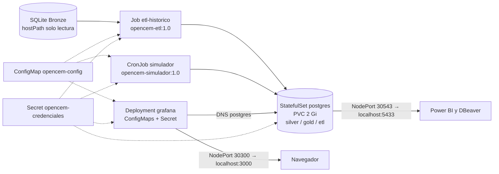

<!-- README.md -->
# Microrred híbrida OpenCEM: BI sobre Kubernetes (enfoque SolarBI)

> *From inverter telemetry to actionable insights: a containerized, Kubernetes-orchestrated BI pipeline for a hybrid microgrid.*

Taller 6 de Inteligencia de Negocios, Institución Universitaria Pascual Bravo, semestre 2026-II.
**Integrantes:** [Nombre Apellido1], [Nombre Apellido2]

## 1. Proyecto

Solución de BI *end-to-end* que transforma la telemetría real de una microrred híbrida (solar + batería + red) del dataset OpenCEM en un modelo dimensional en PostgreSQL, mediante un ETL reproducible con validación de calidad. Se comunica con dos tableros:

- **Power BI** (analítico, para la dirección): autosuficiencia, balance energético, batería y calidad.
- **Grafana** (operativo, para mantenimiento): estado casi en tiempo real y alertas.

**Pregunta central (SolarBI):** ¿qué fracción de la energía que consume la carga se atiende sin tomarla de la red, y qué la explica (sol directo, batería, hora, mes, inversor, eventos)?

Todo corre en un clúster local de Kubernetes (kind, un nodo) y se levanta con un solo comando.

## 2. Arquitectura



- **Bronze:** archivo SQLite original (solo lectura, nunca se modifica).
- **Silver:** esquema `silver`, lecturas limpias agregadas a 15 minutos.
- **Gold:** esquema `gold`, modelo en estrella (`dim_fecha`, `dim_hora`, `dim_inversor`, `dim_tipo_evento`; hechos `fact_energia_15min`, `fact_evento_operativo`, `fact_lectura_reciente`).
- **etl:** bitácora, conteos por regla y conciliación.

## 3. Requisitos del anfitrión

- Windows 10/11 con **Docker Desktop** (WSL2) y **Git Bash**, o Linux/macOS. En Windows, ejecutar los scripts desde Git Bash o WSL2.
- `kind`, `kubectl` y `git` en el PATH.
- ~8 GB de RAM libres y ~12 GB de disco (el SQLite descomprimido pesa 4,4 GB).
- Puertos libres: **5433** (PostgreSQL) y **3000** (Grafana).
- Power BI Desktop y DBeaver para consumir los datos.

## 4. Datos: descarga y verificación (no se incluyen en el repositorio)

Descarguen del registro público de OpenCEM (Zenodo, DOI 10.5281/zenodo.21436223) estos archivos y colóquenlos en `datos/`:

- `opencem-v1.0.0.sqlite.zst` (302,1 MB)
- `opencem-v1.0.0-SHA256SUMS.txt`

```bash
cd datos
sha256sum -c opencem-v1.0.0-SHA256SUMS.txt --ignore-missing
zstd -d opencem-v1.0.0.sqlite.zst -o opencem-v1.0.0.sqlite      # o el paquete Python 'zstandard'
cd ..
```

SHA-256 esperado del `.zst`: `8e38f98209029367a3775799ee9a7c0757cc7e8f2742e4df4eccc45dd4b27517`.
El archivo descomprimido debe quedar en `datos/opencem-v1.0.0.sqlite` (4.439.408.640 bytes).

## 5. Cómo reproducir desde cero

1. Clonar el repositorio y crear el archivo de credenciales (no se versiona):

```bash
cp .env.example .env
# editar .env: cambiar las claves (letras y números, sin comillas simples ni '$')
```

2. Abrir Docker Desktop, detener `docker compose` si está activo (el puerto 5433 debe estar libre) y ejecutar:

```bash
bash up.sh
```

`up.sh` crea el clúster kind, construye y carga las imágenes `opencem-etl:1.0` y `opencem-simulador:1.0`, crea el Secret desde `.env`, aplica los manifiestos, espera a PostgreSQL, lanza el Job del ETL y despliega Grafana y el simulador. Tarda unos 5 a 12 minutos la primera vez.

3. Eliminar todo (el clúster completo, incluidos los datos de PostgreSQL):

```bash
bash down.sh
```

### Accesos

| Servicio | Dirección | Usuario |
|---|---|---|
| PostgreSQL (DBeaver, Power BI) | `localhost:5433`, base `opencem` | `opencem_ro` (solo `SELECT` sobre `gold`) y `opencem_etl` (escritura); claves en `.env` |
| Grafana | http://localhost:3000 | `admin`, clave `GF_SECURITY_ADMIN_PASSWORD` de `.env` |

### Verificación

```bash
kubectl get all -n opencem
kubectl logs job/etl-historico -n opencem --tail=60
```

El ETL termina con un resumen de reglas y conciliación. Si se ejecuta dos veces debe decir `IDEMPOTENCIA: huella IDÉNTICA`.

### Desarrollo local con Docker Compose

```bash
docker compose up -d postgres
docker compose --profile etl run --rm etl
```

(No usar a la vez que el clúster: ambos usan el puerto 5433.)

## 6. Estructura del repositorio

```
README.md  .gitignore  .gitattributes  .dockerignore  .env.example
docker-compose.yml  up.sh  down.sh
diagnostico_sqlite.py  requirements-diagnostico.txt
sql/        DDL (01 a 05, 08), consultas de negocio (06) y JSON (07)
etl/        Dockerfile, requirements.txt, etl.py
simulador/  Dockerfile, requirements.txt, simulador.py
k8s/        namespace, ConfigMap, plantilla de Secret, PostgreSQL, Job ETL, Grafana, CronJob, kind-config
grafana/    dashboard-operacion.json y provisioning (datasource, dashboards, alerting)
powerbi/    proyecto .pbip (modelo semántico en TMDL y reporte)
docs/       negocio y diagnóstico, catálogo de indicadores, modelo dimensional,
            diccionario de datos, justificación de Kubernetes, informe y evidencias
```

## 7. Decisiones principales

- **Silver a 15 minutos:** cubre las cuatro cadencias de la fuente (10,7 a 366 s) y reduce ~3 millones de filas a 56.224.
- **Zona horaria:** la fuente está en UTC; el análisis usa hora local de Shenzhen (Asia/Shanghai, UTC+8). La base guarda UTC y la clave local.
- **Red en 0 V desde 2026-05-03:** se trata como evento operativo, no como error. Por eso existe el indicador de autosuficiencia con red disponible.
- **Seguridad:** credenciales en Secrets (Base64, no cifrado), usuario de solo lectura para Power BI y Grafana, contenedores sin root, exposición solo en 127.0.0.1.
- **Datos personales (Ley 1581 de 2012):** la tabla `context` se trata como dato potencialmente personal; Gold conserva solo una lista blanca de claves del JSON.
- **Power BI en `.pbip`:** texto plano (TMDL y JSON), versionable con Git, a diferencia del `.pbix` binario.

## 8. Limitaciones conocidas

- No hay irradiancia ni temperatura de módulo, así que no se calcula el Performance Ratio.
- El inversor 2 no reporta datos después del 2026-06-22.
- Julio a septiembre de 2025 tienen resolución baja (2 a 8 lecturas por intervalo).
- Los contadores diarios de `statistics` no concilian para el inversor 1; solo se usan para conciliar.
- La tarifa de 900 COP/kWh es un valor de ejemplo, **no una cifra oficial**: [reemplazar por la tarifa real y citar su origen].

## 9. Cita de los datos (CC BY 4.0)

Bartels, T. S., Wu, R., Lu, X., Chen, Y., Lu, Y., Xia, F., Yang, H., Chen, Y., & Li, T. (2026). *OpenCEM: Multimodal photovoltaic and battery microgrid dataset with context records and sky imagery* (Version 1.0.0) [Dataset]. Zenodo. DOI: 10.5281/zenodo.21436223. Artículo de los autores: arXiv:2604.05429.

Los datos se usaron **con transformación** (limpieza y agregación a 15 minutos). Licencia de los datos: CC BY 4.0.