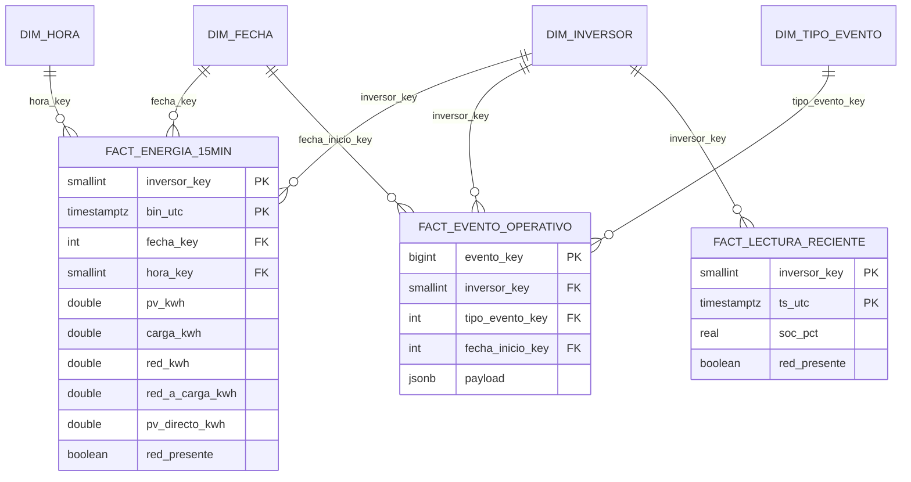

# Modelo dimensional

## 1. Elección: esquema en estrella (star schema)

- Las dimensiones son pequeñas (24 horas, 3 inversores, ~395 fechas, ~60 tipos de evento), así que normalizarlas a copo de nieve no ahorra espacio y sí agrega *joins*.
- Power BI trabaja mejor con una estrella: relaciones uno-a-muchos simples, filtros que fluyen de la dimensión al hecho y medidas DAX más claras.
- Las consultas de negocio (ventanas, comparativos) son más rápidas con pocas uniones.
- Las dimensiones se comparten entre hechos (*conformed dimensions*), lo que permite la matriz de bus.

Capas: Bronze (SQLite, solo lectura) → Silver (`silver.lectura_15min`, `silver.contexto`) → Gold (dimensiones y hechos). El esquema `etl` guarda bitácora, conteos por regla y conciliación.

## 2. Zona horaria

Los timestamps de la fuente son segundos Unix en UTC. El sitio está en Shenzhen (**Asia/Shanghai, UTC+8**, sin horario de verano). Fecha, hora, franja y "día" se calculan en hora local. La base guarda UTC (`timestamptz`) y la clave local (`fecha_key`, `hora_key`, `bin_local`). Como UTC+8 es múltiplo de 15 minutos, cada día local contiene exactamente 96 intervalos. Evidencia: los contadores diarios correlacionan mejor por día local (0,91) que por día UTC (0,85).

## 3. Tablas de hechos y granos

| Hecho | Proceso de negocio | Grano |
|---|---|---|
| `gold.fact_energia_15min` | Balance energético | Un inversor × un intervalo de 15 minutos (UTC) con al menos una lectura válida. PK (`inversor_key`, `bin_utc`) |
| `gold.fact_evento_operativo` | Eventos operativos y contexto | Un evento (una fila de `context` o un evento derivado de telemetría) por inversor. PK `evento_key` |
| `gold.fact_lectura_reciente` | Monitoreo operativo casi en tiempo real | Un inversor × una lectura de ~1 minuto (la alimenta el simulador). PK (`inversor_key`, `ts_utc`) |

## 4. Dimensiones, atributos y jerarquías

| Dimensión | Origen | Clave | Atributos | Jerarquía |
|---|---|---|---|---|
| `gold.dim_fecha` | Calendario generado (tabla de fechas propia); cubre 2025-07-01 a 2026-07-31 | `fecha_key INT` = AAAAMMDD en fecha local | `fecha`, `anio`, `trimestre`, `mes`, `nombre_mes`, `semana_iso`, `dia_mes`, `dia_semana` (1–7), `nombre_dia`, `es_fin_de_semana`, `mes_anio` (AAAA-MM, para ordenar) | Año → trimestre → mes → día |
| `gold.dim_hora` | **Construida por el equipo; no existe en la fuente** | `hora_key` 0–23 (hora local) | `hora`, `franja`, `es_diurno`, `orden_franja` | Franja → hora |
| `gold.dim_inversor` | Parámetros físicos de la documentación del dataset y `settings` | `inversor_key` (1, 2 y 0 = "No aplica / ambos") | `nombre`, `kwp_instalado` (12,48), `bateria_kwh_nominal` (10,24), `potencia_nominal_kw` (8,0), `n_paneles` (26), `potencia_panel_w` (480), `sitio` | Sitio → inversor |
| `gold.dim_tipo_evento` | **Construida por el equipo**: mapea `context_type` a categorías y añade tipos derivados | `tipo_evento_key SERIAL` | `context_type` ('SIN_TIPO' para nulos), `categoria`, `es_critico`, `origen` ('contexto' o 'derivado_telemetria') | Categoría → tipo |

**Franjas de `dim_hora`** (hora local): `madrugada` 0–5, `manana` 6–10, `mediodia_solar` 11–14, `tarde` 15–18, `noche` 19–23. `es_diurno` = horas 6 a 18.

**Categorías de `dim_tipo_evento`:** `carga_computo`, `sistema_ti`, `energia_operativo`, `calendario_solar`, `calidad_datos`, `otro`. Tipos derivados de telemetría: `sin_red_detectado` (crítico) y `bateria_baja_detectada`, ambos en `energia_operativo`. Tipos críticos (`es_critico = true`): `grid_unavailable_or_islanded`, `unexpected_shutdown`, `data_gap`, `power_transition` y `sin_red_detectado`.

**Dimensiones construidas por el equipo (que no existen en la fuente):** `dim_hora` y `dim_tipo_evento`. `dim_fecha` y `dim_inversor` son dimensiones conformes generadas por el equipo a partir de calendario y parámetros físicos.

### Por qué fecha y hora van separadas
Una dimensión de tiempo a 15 minutos tendría ~38 mil filas y duplicaría atributos de fecha. Separándolas, `dim_fecha` es compartida por varios hechos y `dim_hora` permite analizar franjas horarias en cualquier mes. El hecho guarda además `bin_utc` y `bin_local` para el detalle.

## 5. Eventos operativos frente a lecturas

Una **lectura** es una medición continua de variables numéricas en un instante: muchas, densas, regulares y con el mismo grano. Un **evento** es un hecho discreto con inicio, fin, tipo y descripción: pocos, irregulares y semiestructurados (JSON). Mezclarlos en una sola tabla obligaría a columnas casi todas NULL y a un grano ambiguo.

Por eso se modelan como procesos separados con dimensiones conformes (`dim_fecha`, `dim_inversor`). Se relacionan por inversor y por solapamiento de tiempo (`inicio_utc` ≤ `bin_utc` < `fin_utc`), lo que permite preguntas como "¿cuánto sube la carga durante entrenamientos GPU?".

Distinción de calidad que aplica el modelo:
- **Dato inválido:** físicamente imposible o contradictorio con otra medida de la misma lectura. Se corrige o excluye en Silver y queda contado en `etl.regla_limpieza`.
- **Evento operativo real:** físicamente coherente y persistente o respaldado por otras variables o por el contexto (red en 0 V, SoC bajo, huecos, apagados). Se conserva y se modela en `fact_evento_operativo`.

## 6. Matriz de bus

| Proceso / hecho | dim_fecha | dim_hora | dim_inversor | dim_tipo_evento |
|---|---|---|---|---|
| `fact_energia_15min` | ✔ | ✔ | ✔ | — |
| `fact_evento_operativo` | ✔ (inicio) | — | ✔ | ✔ |
| `fact_lectura_reciente` | (derivable de `ts_utc`) | — | ✔ | — |

## 7. Diagrama

## 8. Vistas de consumo

- `gold.vw_kpi_dia`: inversor × día (energías, SSR, cobertura solar directa, disponibilidad, % válidos, SoC mínimo, ciclos equivalentes, horas sin red, costo con la tarifa de `gold.parametro`).
- `gold.vw_kpi_mes`: lo mismo por mes.
- `gold.parametro (nombre, valor)`: contiene `tarifa_cop_kwh` (900 de ejemplo).

## 9. Restricciones e índices (se justifican en la Fase 3)

- PK compuestas: evitan duplicados y soportan idempotencia con `INSERT … ON CONFLICT`.
- FK de hechos a dimensiones; `CHECK` de rangos (SoC 0–100, energías ≥ 0).
- BRIN en `bin_utc` de `fact_energia_15min` o B-tree compuesto `(fecha_key, inversor_key)`.
- B-tree en `fact_evento_operativo (inversor_key, inicio_utc)`.
- GIN con `jsonb_path_ops` sobre `payload` para consultas con `@>`.
- B-tree en `fact_lectura_reciente (inversor_key, ts_utc DESC)` para el estado actual.